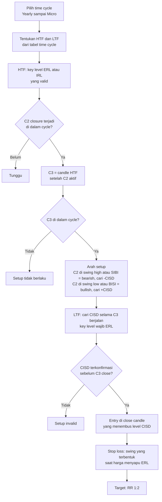
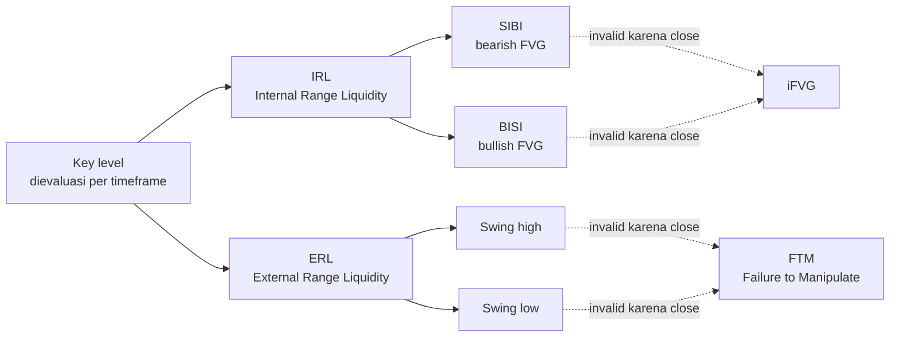
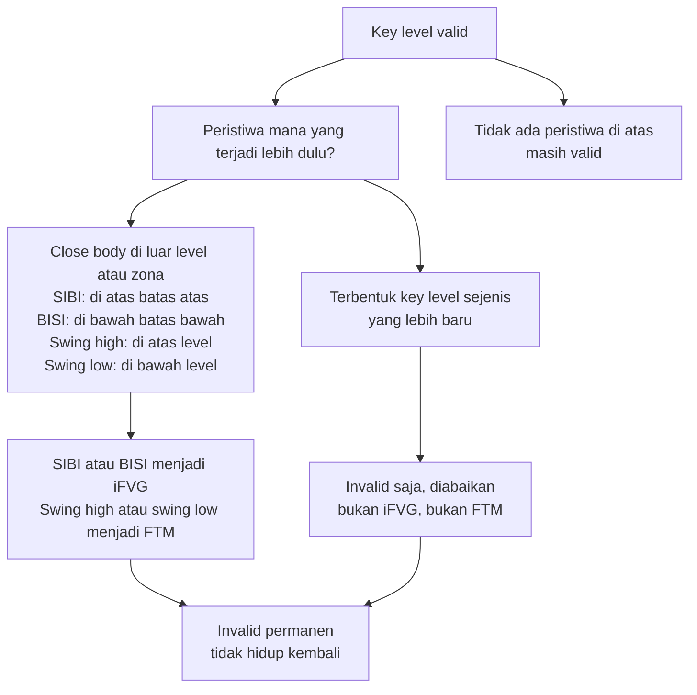
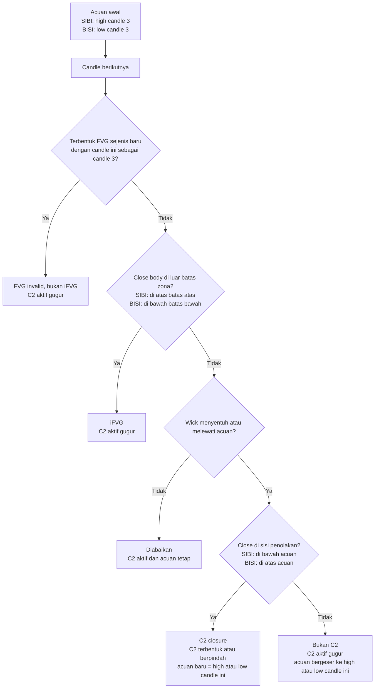
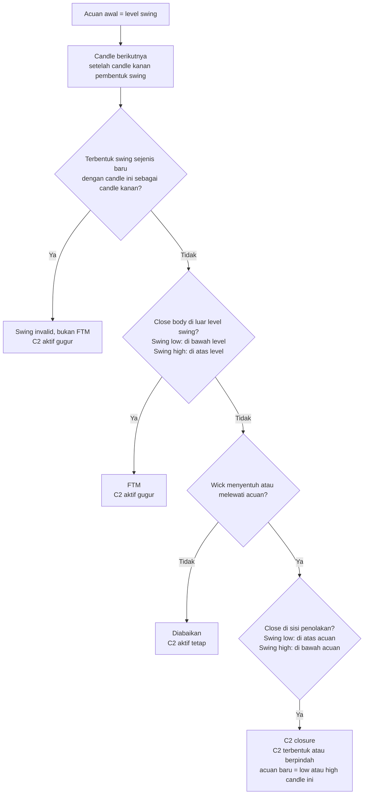
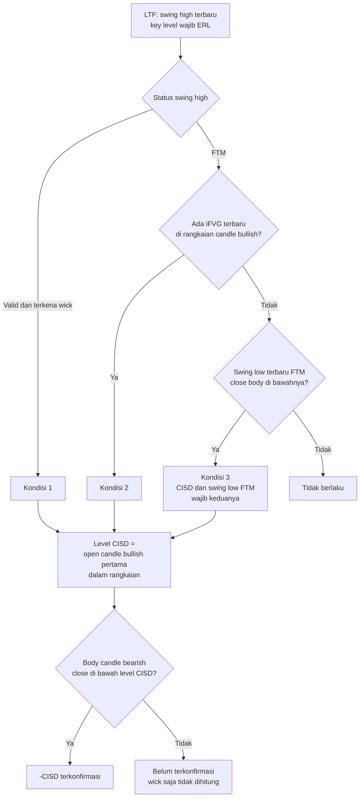
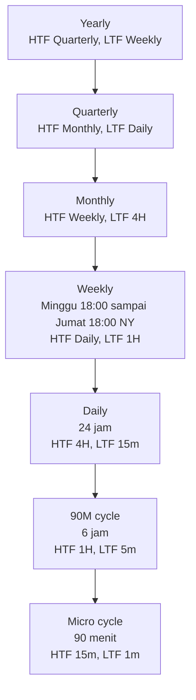

# Diagram Mermaid

Kumpulan diagram dari dokumen-dokumen metode ini. Setiap diagram merujuk ke dokumen sumbernya. Jika ada perbedaan, **dokumen sumber yang berlaku**.

| No | Diagram | Sumber |
|---|---|---|
| 1 | Alur setup dari time cycle sampai entry | `alur-entry.md`, `time-cycle.md` |
| 2 | Jenis key level | `key-level-irl.md`, `key-level-erl.md` |
| 3 | Status key level: valid, iFVG, FTM, atau digantikan | `key-level-irl.md`, `key-level-erl.md` |
| 4 | Evaluasi C2 closure pada IRL (SIBI/BISI) | `c2-closure-irl.md` |
| 5 | Evaluasi C2 closure pada ERL (swing high/low) | `c2-closure-erl.md` |
| 6 | Bearish CISD (-CISD) | `cisd.md` |
| 7 | Hierarki time cycle | `time-cycle.md` |

---

## 1. Alur setup dari time cycle sampai entry

---

## 2. Jenis key level

---

## 3. Status key level

Berlaku untuk SIBI, BISI, swing high, dan swing low. Invalid bersifat permanen, dan hanya key level sejenis yang paling baru yang bisa valid.

---

## 4. Evaluasi C2 closure pada IRL (SIBI/BISI)

Bearish dan bullish adalah kebalikan. Evaluasi candle satu per satu setelah candle 3, dengan urutan ini.

---

## 5. Evaluasi C2 closure pada ERL (swing high/low)

Swing low adalah sisi bullish, swing high adalah kebalikannya. Evaluasi dimulai dari candle setelah candle kanan pembentuk swing.

---

## 6. Bearish CISD (-CISD)

Bullish CISD (+CISD) adalah kebalikannya: swing low, rangkaian candle bearish, open candle bearish pertama, dan body bullish yang menembus level.

---

## 7. Hierarki time cycle

Semua cycle aktif bersamaan. Jam mulai semua putaran adalah 18:00 NY. Kotak menunjukkan HTF dan LTF yang dipakai bila cycle tersebut dipilih.

